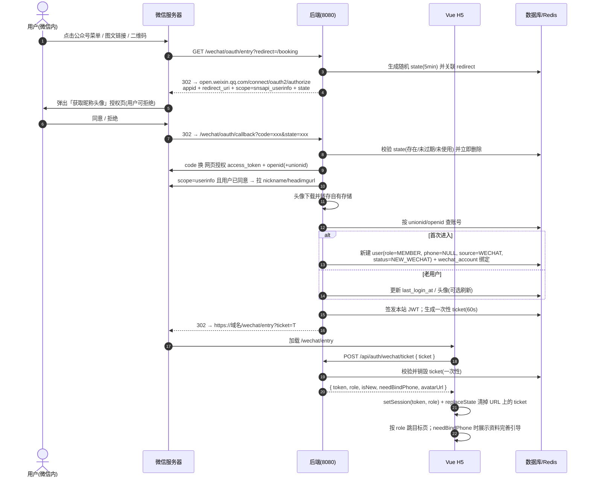
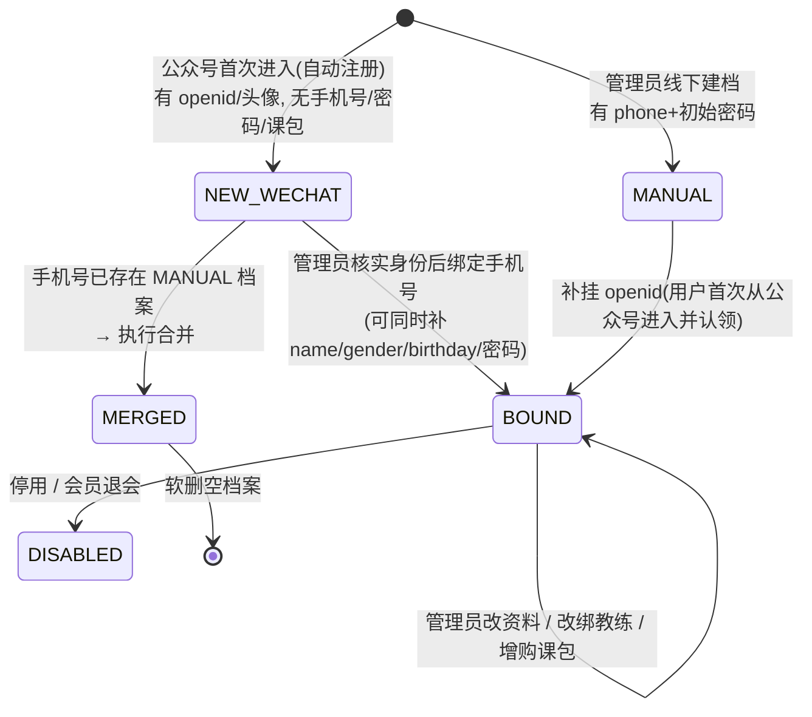
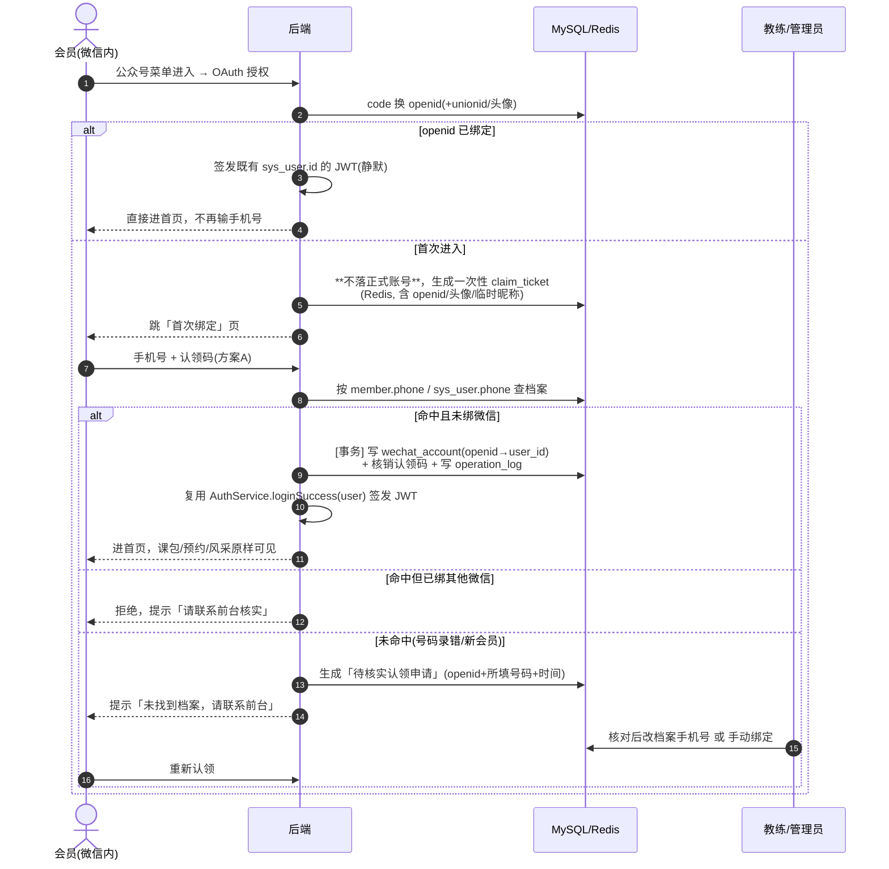

# 公众号入口对接设计方案（预留稿 · 待决策，尚未开发）

> 状态：**§17 认领方案 + §16 预约通知均已实施**（2026-11-06）；Q9~Q14 已拍板。
> 创建日期：2026-11-06
> 适用范围：Vue3 + Vite 会员端 H5、管理端 H5、后端服务（`localhost:8080`）、后端仓库 `C:/Users/user/IdeaProjects/jianshenfang`
> 不在本次范围：短信验证码、小程序、微信支付、公众号群发；**预约通知消息见 §16（待决策）**
> 实施落地记录见 §17.10，生产上线前置见 §17.11。

---

## 0. 一页速读（给决策者）

| 问题 | 结论 |
|---|---|
| 公众号能拿到什么 | **openid / unionid**；用户点「同意授权」后还能拿到**微信头像、昵称** |
| 公众号能拿到手机号吗 | **不能**。`getPhoneNumber` 是小程序能力，公众号网页无此接口。手机号由**教练/管理员建档时录入**，会员首次登录用手机号认领；不接短信 ⇒ 无验证手段，需线下二次凭证（§17） |
| 公众号能发预约通知吗 | **能，但有限制**：认证服务号 + 用户关注 + 固定模板。**Q9~Q11 已拍板并实施**：预约成功/取消通知 + 上课前 24h 提醒 + 引导关注页，见 §16 |
| 自动注册可行吗 | **不能直接建「无手机号账号」**：后端 `sys_user.phone` / `member.phone` 均 `NOT NULL + UNIQUE`（`schema.sql:4,17`）。改为「首次进入持临时票据 → 填手机号认领既有档案 → 签发该档案的 JWT」，见 §17 |
| 最大的改造难点 | **不是微信授权，是认领环节的身份强度**（无短信时仅凭手机号可冒领他人课包）+ **避免新建空账号后的数据合并**。修订方案见 §17 |
| 对现有代码的最大冲击 | 现有注册/登录/找回密码**全部依赖短信**（见 §2.3），不接短信必须下线或改造这 4 条链路 |
| 硬前置条件 | **已微信认证的服务号** + 已备案域名 + HTTPS + 后台配置「网页授权域名」。订阅号/未认证号无网页授权权限 |
| 预计工作量 | 核心接入 ≈ 8 人日；若加预约通知 ≈ +2.5 人日（§12，不含资质/域名备案等待）。§17 的「openid 直绑既有账号」比 §6 的「合并两份档案」更省 |

**当前只剩 3 件事**：① 资质是否具备（Q1，硬阻塞）；② 头像是否允许上传覆盖（Q6）；③ 是否与小程序共用 storage adapter（Q8）。Q9~Q14 已拍板并实施、Q2 已按推荐落地、Q3~Q5/Q7 已被 §17 方案取代，分组见 §14。

---

## 1. 现状盘点（基于当前代码事实）

| 项 | 现状 | 位置 |
|---|---|---|
| 技术栈 | Vue 3 + Vite + `vue-router`（`createWebHistory`），纯 H5 SPA | `package.json`、`vite.config.ts` |
| 登录态 | `Bearer JWT` 存 `localStorage`，另有 `jsf_role` | `src/api/index.ts:1-15` |
| 401 处理 | 清 token 后 `window.location.href = '/login'` **硬跳** | `src/api/index.ts:24-27`、`:41-44` |
| 路由守卫 | 除 `/login` 外全部要 token；按 `MEMBER` / `ADMIN` / `COACH` 分流 | `src/router/index.ts:38-47` |
| 认证接口 | `sms-code`、`register`、`login/password`、`login/code`、`password/reset` | `src/api/index.ts:52-62` |
| 短信 | 登录页有「获取验证码」，后端返回 `mockCode`（开发环境模拟短信） | `src/views/LoginView.vue:22-40` |
| 会员字段 | `name` / `phone` / `gender` / `birthday` / `coachId` / `password`，**phone 必填** | `src/views/admin/MemberAddView.vue:11-27` |
| 会员详情 | 展示 name、phone、生日、课包、预约记录；`NavBar` 的「编辑」**只显示文字、未绑定事件，功能不存在** | `src/views/admin/MemberDetailView.vue:59` |
| 会员「我的」 | 头像为姓名首字占位，无图片头像 | `src/views/MineView.vue:46` |
| 请求基址 | dev 用 Vite proxy `/api`、`/upload` → `localhost:8080` | `vite.config.ts:9-12` |

**关键结论**：现有模型把 `phone` 当成「登录账号 + 唯一标识」，这是本次改造最大的结构性冲突——微信用户没有手机号。必须把「身份主键」从 phone 改成内部 `user_id`，phone 降级为「可选的联系方式/登录名」。

---

## 2. 必须先讲清的约束（决定方案长什么样）

### 2.1 微信侧能力边界

| 能力 | 是否可用 | 说明 |
|---|---|---|
| 静默拿 openid（`snsapi_base`） | ✅ | 用户无感，不弹窗，不要求关注公众号 |
| 拿头像昵称（`snsapi_userinfo`） | ⚠️ 有条件 | 会弹「获取你的昵称、头像」授权页，用户**可以点拒绝**；且昵称头像可能为空（用户未设置 / 隐私设置） |
| 拿手机号 | ❌ | 公众号网页无此能力，只有小程序 `getPhoneNumber`；不接短信 ⇒ 只能人工录入 |
| 跨端统一身份（unionid） | ⚠️ 需条件 | 需把公众号绑定到微信开放平台；否则只有 openid，**将来接小程序会产生两套账号** |
| 头像 URL 长期可用 | ❌ | `wx.qlogo.cn` 外链有防盗链/失效风险，用户换头像后旧链接可能 404 |

**设计应对**：
- 推荐主流程用 `snsapi_userinfo`，**用户拒绝授权时降级为仅有 openid 的注册**，头像用默认占位，流程绝不中断；
- 头像由**后端下载并转存到自有存储**（现有 `/upload` 链路可复用），数据库只存本站 URL；
- 若将来可能做小程序，**现在就把 `unionid` 字段建好**，身份匹配优先级 `unionid > openid`。

### 2.2 「不接短信」带来的直接后果

1. 手机号**无法验证**：不能证明这个手机号属于该用户，只能视为「管理员核实身份后代为登记」。
2. 因此**不能**把手机号绑定做成用户自助填写即生效；绑定必须是管理员动作，且要有操作日志。
3. 用户若忘记密码，**没有自助找回通道**，只能管理员后台重置。
4. 现有 4 条短信链路必须处理（见 §2.3）。

### 2.3 现有短信链路的处置（二选一，需拍板）

| 方案 | 做法 | 影响 |
|---|---|---|
| **A（推荐）彻底下线** | 移除 `/auth/sms-code`、`/auth/register`、`/auth/login/code`、`/auth/password/reset`；登录页只保留「手机号 + 密码」；注册统一由管理员建档 / 公众号自动注册；忘记密码改为「请联系前台重置」，并把默认密码 `123456` 改为首次登录强制改密 | `LoginView.vue` 大幅简化，删掉验证码 UI、倒计时、`mockCode` 提示 |
| B 仅本地保留 | 生产环境用开关禁用短信入口，dev 保留 `mockCode` 便于调试 | 前端多一个环境判断，长期容易成为安全死角（生产误开等于任意手机号可登录） |

> 建议 A。既然确定不接短信，就不要留一条"仅测试可用"的认证后门。

### 2.4 资质与配置前置（阻塞项，需提前办理）

- 已微信认证的**服务号**（订阅号无网页授权接口权限），拿到 `AppID` / `AppSecret`；
- 已 ICP 备案的域名 + HTTPS 证书（微信只接受 80/443 且不能带端口）；
- 公众号后台 →「网页授权域名」配置为 H5 域名，并把校验文件放到域名根目录；
- 后端服务器出口 IP 加入公众号「IP 白名单」；
- 生产 Nginx 把 `/api`、`/upload`、`/wechat` 反代到后端，**保持同域**（微信回调域名、前端 AJAX 同域，避免跨域和 Cookie 问题）；现有 Vite proxy 仅用于本地开发。

---

## 3. 总体流程

### 3.1 时序图



### 3.2 分步说明

| # | 步骤 | 要点 |
|---|---|---|
| 1 | 入口 | 菜单/图文/二维码的 URL **一律指向后端** `/wechat/oauth/entry`，不要直接指向 Vue 页面。`redirect` 参数白名单校验（只放行站内相对路径），防止开放重定向 |
| 2 | state | 后端生成随机串存 Redis（TTL 5min），回调时校验并**立即删除**，防 CSRF / 重放 |
| 3 | 授权 scope | 首次 `snsapi_userinfo`；已授权过的用户可改走 `snsapi_base` 静默（减少弹窗）。用户点「拒绝」时仍会带 code 回调，用它换 openid 后**继续注册**，只是头像为空 |
| 4 | code 换 openid | `code` 一次性、5 分钟有效；`AppSecret` 只在后端，前端永远不接触 openid 之外的微信凭证 |
| 5 | 头像 | 后端 `GET headimgurl` → 校验图片类型/大小 → 走现有 `/upload` 存储 → 落库本站 URL。**前端不直接引用 `wx.qlogo.cn`**。失败或为空 → 默认占位，不阻断注册 |
| 6 | 自动注册 | 一律创建 `role=MEMBER`，**永不授予 ADMIN/COACH**；`phone=NULL`、无密码、无课包、`status=NEW_WECHAT` |
| 7 | 回传登录态 | **不要把 JWT 拼在 URL 上**（会被浏览器历史、微信、Nginx 日志记录）。用一次性 `ticket` 换 token |
| 8 | 前端落地 | 新增 `/wechat/entry` 路由并加入守卫白名单；拿到 token 后 `setSession()`（沿用现有机制），`router.replace()` 到目标页；用 `history.replaceState` 清掉地址栏 ticket，避免刷新重放 |
| 9 | 401 兜底 | 现有 `request()` 401 硬跳 `/login` 会在微信里把用户丢到账号密码页。改为：若会话来源是微信 → 302 回 `/wechat/oauth/entry` 静默重登；否则才去 `/login` |

### 3.3 三个必须幂等的点

- `code` 重复使用 / 用户狂点菜单 / 微信重试回调 → 按 `unionid/openid` 查得到账号就不重复建；
- `ticket` 只能用一次，用后即删，过期返回明确错误让前端重新走授权；
- 自动注册与管理员建档并发 → 依赖数据库唯一约束（§5.2），不靠应用层 `if` 判断。

---

## 4. 账号状态机



| 状态 | 含义 | 公众号自动登录 | 手机号+密码登录 | 约课 |
|---|---|---|---|---|
| `NEW_WECHAT` | 微信自动注册，资料待完善 | ✅ | ❌ | **待拍板**（§10-Q3） |
| `MANUAL` | 管理员建档 | ❌（尚未挂 openid） | ✅ | ✅ |
| `BOUND` | 已完成手机号绑定 | ✅ | ✅（若设了密码） | ✅ |
| `MERGED` | 合并后废弃的空档案 | ❌ | ❌ | ❌ |
| `DISABLED` | 停用 | ❌ | ❌ | ❌ |

> 建议：`NEW_WECHAT` **允许浏览、允许看课表，但预约/购课需先绑定手机号**（§10-Q3 选 B）。健身房是线下履约场景，完全放开容易产生僵尸预约。

---

## 5. 数据模型改造

> 以下为 MySQL 风格示意，字段命名按现有后端实际技术栈调整。**核心是约束，不是具体列名。**

### 5.1 用户表 `user` 增字段

| 字段 | 类型 | 说明 |
|---|---|---|
| `phone` | varchar(11) **NULL** | 由 NOT NULL 改为可空；建议「非空才唯一」的部分唯一索引 |
| `source` | enum(`MANUAL`,`WECHAT`) | 账号来源，便于统计与分流 |
| `status` | enum(`NEW_WECHAT`,`MANUAL`,`BOUND`,`MERGED`,`DISABLED`) | 见 §4 |
| `avatar_url` | varchar(512) NULL | 本站存储路径；`MANUAL` 账号可无 |
| `nickname` | varchar(64) NULL | 微信昵称（仅作展示，不用于身份判断） |
| `wechat_bound_at` | datetime NULL | 绑定时间 |
| `phone_bound_at` | datetime NULL | 手机号绑定时间 |
| `phone_bound_by` | bigint NULL | 操作管理员 id（审计） |
| `role` | 保持现状 | 微信注册**只允许 MEMBER** |
| `password` | 保持现状，可空 | 微信账号为空；管理员绑定时可设初始密码 |

### 5.2 新表 `wechat_account`

```sql
CREATE TABLE wechat_account (
  id            BIGINT PRIMARY KEY AUTO_INCREMENT,
  user_id       BIGINT       NOT NULL COMMENT '本站 user.id',
  appid         VARCHAR(64)  NOT NULL,
  openid        VARCHAR(64)  NOT NULL,
  unionid       VARCHAR(64)  NULL,
  scope         VARCHAR(32)  NULL     COMMENT '最近一次授权范围',
  wx_nickname   VARCHAR(128) NULL,
  wx_headimgurl VARCHAR(512) NULL     COMMENT '微信原始URL, 仅留档',
  created_at    DATETIME     NOT NULL,
  updated_at    DATETIME     NOT NULL,
  UNIQUE KEY uk_appid_openid (appid, openid),
  UNIQUE KEY uk_user (user_id),
  KEY idx_unionid (unionid)
);
```

- `uk_appid_openid` 保证一个微信号在一个公众号下只有一个账号（幂等自动注册靠它）；
- `uk_user` 禁止一个本站账号挂多个微信号（如需换绑，先解绑）；
- `unionid` 不设唯一（多公众号场景下同一 unionid 可对应多条，按 appid 区分），但身份匹配优先用它。

### 5.3 新增审计表 `member_change_log`

管理员每次改资料/绑手机号都留痕：`admin_id`、`user_id`、`field`、`old_value`、`new_value`、`ip`、`created_at`。手机号是敏感字段且无短信验证，**没有日志就无法追溯误绑/冒领**。

### 5.4 其他约束

- 手机号唯一性：`UNIQUE` 只在 `phone IS NOT NULL AND status != 'MERGED'` 上生效（MySQL 可用生成列 + 唯一索引实现）；
- `MERGED` 档案软删，不物理删除（保留审计链）；
- `access_token` / `ticket` / `state` 存 Redis 并设 TTL，不落业务表。

---

## 6. 手机号绑定与账号合并（初版设计 · 已被 §17 修订）

> ⚠️ **本节为初版（假设「微信自动注册一个空账号」）**。结合后端 `C:/Users/user/IdeaProjects/jianshenfang` 代码复核后，发现该路径既插不进数据（两表 `phone NOT NULL + UNIQUE`）、又需迁移 9 张表。**请以 §17「手机号认领 + openid 直绑既有档案」为现行方案**；本节保留作为对比与决策依据（其中审计日志、唯一约束、冲突处理的原则仍然有效）。

### 6.1 为什么必须设计

管理员建档必填手机号（`MemberAddView.vue:11`），微信自动注册没有手机号。用户在公众号里玩了几天、到店报了手机号，后台很可能**已经存在**一份 `MANUAL` 档案。于是同一个真人会有两个账号。

### 6.2 绑定入口只放在管理端

- 用户侧：只展示「资料待完善，请到前台核实后由工作人员补充」，**不提供自助输入手机号即生效**；
- 管理员侧：`/admin/members/:id` 详情页「编辑」按钮（目前是空壳）真正实现，弹窗含 `手机号 / 姓名 / 性别 / 生日 / 头像 / 初始密码(可选)`；
- 会员列表增加筛选与标签：`微信注册/待绑定`、是否已挂 openid。

### 6.3 三种场景的处理

| 场景 | 判定 | 动作 |
|---|---|---|
| **S1 手机号未被占用** | `SELECT ... WHERE phone=?` 无结果 | 在当前 `NEW_WECHAT` 档案上直接 `UPDATE phone/name/...`，状态 → `BOUND`，写审计日志 |
| **S2 手机号已属于一个 `MANUAL` 档案** | 查到档案且无 openid | **合并**：把 `wechat_account.user_id` 改指向 `MANUAL` 档案；`MANUAL` 档案补 `avatar_url/nickname`、状态 → `BOUND`；`NEW_WECHAT` 空档案标记 `MERGED` 软删（若已有课包/预约数据，先迁移再软删，事务内完成） |
| **S3 手机号已属于另一个微信档案** | 查到档案且已有 openid | **拒绝并提示**：「该手机号已绑定其他微信」，交人工核实；提供管理员手动「解绑旧微信 → 重新绑定」的高权限操作，全程留痕 |

**合并事务要求**：`UPDATE wechat_account` + 数据迁移 + 空档案软删 + 审计日志，必须在**同一个数据库事务**里；接口幂等（重复提交返回同一结果，不产生第二条日志）。

### 6.4 防冒领与误填

- 手机号是「人工核实」结果，不是「验证」结果 → UI 上必须写清楚「请核对会员身份后再填写」，保存二次确认；
- 绑定后不立即开放「手机号+密码登录」，除非管理员同时设置了初始密码并要求首次登录改密；
- **身份主键始终是 `user_id` + openid/unionid，绝不用 phone 反查合并**——手机号可能被换号、被复用；
- 提供「解绑微信」与「更换手机号」两个独立操作，都记日志。

---

## 7. 管理员修改用户信息

| 项 | 设计 |
|---|---|
| 入口 | `views/admin/MemberDetailView.vue` 的 `<NavBar :right="'编辑'">` 绑定 `@right` 打开编辑弹窗（现为死按钮） |
| 可改字段 | `name`、`phone`、`gender`、`birthday`、`avatar_url`、`初始密码(可选)`、`coachId` 沿用现有 `rebindCoach` |
| 不可改 | `id`、`role`、`openid/unionid`、`source`、`课包节数`（课包走 `addPackage` / `adjustPackage`，已有日志语义） |
| 校验 | 手机号格式 `^1\d{10}$`、占用检测（§6.3）、姓名长度、生日合法性；头像只能走上传接口，不接受外链 URL |
| 权限 | 仅 `ADMIN`；`COACH` 只读（沿用现有路由守卫对 `/admin/` 的控制） |
| 头像展示 | 详情/列表/`MineView` 统一：`avatar_url` 有值显示 ``，无值回退到姓名首字占位（现有逻辑） |
| 反馈 | 保存成功刷新详情；手机号冲突返回明确文案，不清空表单 |

---

## 8. 接口契约（前后端约定）

统一响应体沿用现有 `{ code, message, data }`，`code=0` 成功。`Bearer JWT` 沿用现状。

### 8.1 后端新增（微信侧，无需 token）

| 方法 | 路径 | 说明 |
|---|---|---|
| GET | `/wechat/oauth/entry?redirect=...` | 生成 state → 302 到微信授权地址 |
| GET | `/wechat/oauth/callback?code=&state=` | 校验 state → 换 openid/头像 → 自动注册 → 302 回前端带 ticket |

### 8.2 前端调用的新增接口（`/api` 前缀）

| 方法 | 路径 | 请求 | 响应 `data` |
|---|---|---|---|
| POST | `/auth/wechat/ticket` | `{ ticket }` | `{ token, role, isNew, needBindPhone, avatarUrl, nickname }` |
| GET | `/member/me` | — | **扩展**现有返回：加 `avatarUrl`、`phoneBound`、`status`、`source` |
| GET | `/admin/members` | — | **扩展**列表项：加 `source`、`status`、`hasWechat`、`avatarUrl` |
| GET | `/admin/members/{id}` | — | **扩展**详情：加上述字段 + `openid 绑定状态`（不返回完整 openid） |
| PUT | `/admin/members/{id}` | `{ name?, phone?, gender?, birthday?, avatarUrl?, password? }` | `{ needMerge, conflictUserId? }` 或提交合并确认 |
| GET | `/admin/members/check-phone?phone=` | — | `{ exists, userId, hasWechat }`，编辑弹窗失焦时预检，减少 S2/S3 撞车 |
| DELETE | `/admin/members/{id}/wechat` | — | 解绑微信（高权限 + 审计） |

> `PUT` 建议拆成「预检 → 确认」两步：命中 S2 时返回 `needMerge=true`，管理员在弹窗里看到「检测到已存在同名档案，合并后将保留其课包与预约记录」，点确认才执行事务。避免静默合并。

### 8.3 下线/禁用接口（取决于 §2.3 决策）

`/auth/sms-code`、`/auth/register`、`/auth/login/code`、`/auth/password/reset` → 方案 A 全部移除；方案 B 生产环境返回 `403`。

### 8.4 错误码建议

| code | 含义 | 前端动作 |
|---|---|---|
| 40001 | ticket 无效/过期/已使用 | 重新走公众号授权，不显示登录页 |
| 40002 | state 校验失败 | 提示「请在微信内重新打开链接」 |
| 40003 | 微信授权被拒绝（仍已用 openid 完成注册） | 静默继续，头像占位 |
| 40004 | 非微信环境访问微信入口 | 回落普通登录页 |
| 40101 | 手机号已被占用且已绑定其他微信（S3） | 提示人工核实 |
| 40102 | 无权限修改该会员 | toast |
| 50001 | 微信接口异常（40163 code 已用、48001 无接口权限、40029 无效 code） | 记录服务端日志 + 友好提示，重试一次授权 |

> 微信原始错误码（40029/40163/48001 等）只在服务端日志出现，**不要透传给前端**。`48001` 出现即说明服务号未认证/无网页授权权限。

---

## 9. 前端改造清单（拟，按文件）

| 文件 | 改动 |
|---|---|
| `src/router/index.ts` | 新增 `/wechat/entry` 并设 `meta.public`；守卫增加「微信会话 401 → 重新授权」分支；保留原有 role 分流 |
| `src/views/WechatEntryView.vue`（新增） | 取 `ticket` → 换 token → `setSession` → `replaceState` 清 URL → 跳转；`needBindPhone` 时展示资料完善引导页；全程 loading/错误态 |
| `src/api/index.ts` | 新增 `wechatTicket`、`checkPhone`、`updateMember`、`unbindWechat`；`request()` 401 改为可配置回调而非硬跳 `/login`；移除 4 个短信接口（方案 A）；`me()` 字段透传 |
| `src/views/LoginView.vue` | 方案 A：删验证码 UI、`sendCode`、倒计时、`mockCode` 提示，只留手机号+密码；「忘记密码」改为联系前台文案；加「微信内打开自动登录」说明 |
| `src/views/MineView.vue` | 头像支持图片；`phone` 为空时展示「未绑定手机号 · 请到前台完善」；去掉可能误导的「退出登录」在微信会话中的语义（改为「切换账号」提示） |
| `src/views/admin/MemberDetailView.vue` | 实现「编辑」弹窗（§7）、头像展示、微信来源标签、手机号冲突预检 |
| `src/views/admin/MembersView.vue` | 增加「来源 / 绑定状态」筛选与标签 |
| `src/views/admin/MemberAddView.vue` | 文案区分「线下建档」与「微信自动注册」；默认密码改掉或加首次改密标记 |
| `vite.config.ts` | dev proxy 增加 `/wechat` → 8080，便于本地调试回调 |
| 生产 Nginx | `/api`、`/upload`、`/wechat` 同域反代；放置微信域名校验文件 |

---

## 10. 预留期（现在不开工）必须遵守的约定

> 这一节是「预留」的真正价值：即使本次一行代码都不写，后续开发也要按这些约定推进，否则将来会返工。

1. **不要把 `phone` 当主键**：任何新表/新接口都不要以 phone 做关联键，一律用 `user_id`。
2. **新增字段允许为空**：头像、手机号、生日都按可空设计，前端不要写 `member.phone.slice(...)` 这类无判空访问。
3. **认证入口保持可插拔**：`setSession/getToken/clearSession` 已经是集中封装（好事），将来只需加一种 `source`，不要在各页面散写登录判断。
4. **不要在业务页里判断「是否已登录」**，只依赖路由守卫 + `request()` 统一处理，方便以后换静默重登逻辑。
5. **不要新增依赖短信的功能**（如手机号变更验证、二次确认），否则与「不接短信」冲突。
6. **`localStorage` 存 token 的方式先沿用**（若后续做小程序迁移，这一层要一起抽象成 storage adapter，与上一轮《uni-app 迁移评估》合并考虑）。
7. **微信相关常量只放后端**：`AppID/AppSecret/state/ticket` 不得进前端代码、`.env` 前端变量或 Git 仓库。
8. **手机号唯一约束先别在库里加死**：等 §5 的合并规则确定后再加，否则微信自动注册会直接插不进去。
9. **隐私政策与用户协议**：`LoginView.vue:123` 已有「登录即代表同意…」文案，需补上「收集微信头像、昵称、openid 用于账号识别」的说明（《个人信息保护法》告知义务），上线前完成。
10. **预留 unionid 字段**：即使当前只做公众号，也把字段建好，避免将来接小程序时两套账号。

---

## 11. 安全与合规检查表

- [ ] `AppSecret` 仅存后端配置/密钥管理，服务端日志脱敏，不进 Git
- [ ] `state` 随机、一次性、5 分钟 TTL；`redirect` 参数白名单校验，防开放重定向
- [ ] `code` 一次性；`ticket` 一次性 + 60s TTL；JWT 不出现在 URL、Referer、日志
- [ ] 前端永不接收、永不上传 `openid`（防伪造身份）；openid 只由后端用 code 换取
- [ ] 自动注册角色硬编码 `MEMBER`，服务端不信任任何前端传来的 `role`
- [ ] 头像转存前校验 `Content-Type`、大小上限，防 SSRF（只请求 `wx.qlogo.cn` 域名白名单）
- [ ] 管理端所有写操作做 `ADMIN` 权限校验 + 审计日志，不依赖前端隐藏按钮
- [ ] 敏感字段（手机号、openid）在列表接口中脱敏或按需返回
- [ ] 提供「解绑微信 / 注销账号 / 删除头像」路径，满足个人信息删除权
- [ ] 生产全站 HTTPS；`/api` 与 `/wechat` 同域；Vite dev proxy 不用于生产
- [ ] 隐私政策更新后再上线

---

## 12. 分阶段实施计划（若决定开发）

| 阶段 | 内容 | 人日 | 可验证产物 |
|---|---|---|---|
| P0 前置 | 认证服务号、备案域名、HTTPS、网页授权域名、IP 白名单、Nginx 同域反代 | 0.5（等待期以天/周计） | 微信授权页能正常弹出 |
| P1 后端数据 | `user` 加字段、`wechat_account`、`member_change_log`、唯一约束、phone 改可空 | 1 | 迁移脚本 + 回滚脚本 |
| P2 后端授权 | entry/callback/state/ticket/openid/头像转存/自动注册/JWT | 2 | 微信里打开菜单能进首页，刷新不重复建号 |
| P3 前端接入 | 新路由、entry 页、api、401 兜底、头像展示 | 1 | 微信内 + 普通浏览器两条路径都通 |
| P4 管理端 | 编辑弹窗、手机号预检、合并事务、审计日志、列表标签 | 1.5 | S1/S2/S3 三个场景全部跑通 |
| P5 短信下线 | 按 §2.3 方案 A 清理 4 条链路 + 登录页改造 | 0.5 | 生产无任何短信入口 |
| P6 联调验收 | §13 用例、真机（iOS/Android 微信）、异常与并发测试 | 1.5 | 验收报告 |
| P7 预约通知（可选，待 Q9 决策） | 模板/订阅配置、关注状态维护、发送服务与日志、定时提醒、退订 | 2.5 | §16 验收用例通过 |

**核心接入合计 ≈ 8 人日**；含 P7 则 ≈ 10.5 人日（不含资质/备案等待）。建议 P0 与 P1 并行启动，因为资质等待时间不可控；P7 依赖 P0 中「模板消息插件/订阅通知插件」是否开通。

---

## 13. 验收用例

| # | 场景 | 期望 |
|---|---|---|
| 1 | 新用户首次从公众号菜单进入，同意授权 | 自动建 `MEMBER` 账号，头像为本站 URL，直达首页 |
| 2 | 同上但点「拒绝授权」 | 仍自动注册成功，头像占位，流程不中断 |
| 3 | 老用户再次进入 | 不新建账号，不重复写入 `wechat_account` |
| 4 | 回调 URL 刷新 / code 重放 / ticket 重放 | 不重复登录，给出明确提示或静默重授权 |
| 5 | 普通浏览器（非微信）打开菜单链接 | 回落普通登录页，不报错白屏 |
| 6 | 微信会话 token 过期后点任意页面 | 静默重授权回到原页面，不跳账号密码页 |
| 7 | 管理员给微信账号绑一个未被占用的手机号（S1） | 状态 → BOUND，写审计日志 |
| 8 | 管理员绑定的手机号已有线下档案（S2） | 弹出合并确认，确认后课包/预约保留，空档案软删 |
| 9 | 手机号已绑其他微信（S3） | 明确拒绝，不产生脏数据 |
| 10 | 并发：两次回调 / 两人同时绑同一手机号 | 唯一约束兜底，只成功一次 |
| 11 | 生产环境访问 `/auth/sms-code` 等 | 404/403，无短信发送能力 |
| 12 | 微信换头像、头像外链失效 | 页面仍显示本站转存的旧头像，无裂图 |
| 13 | 已关注用户提交预约 | 收到预约成功模板消息，点击可跳 `/bookings` 详情 |
| 14 | 未关注用户提交预约 | 不报 43004；按 §16 走一次性订阅或提示引导关注，接口失败有降级记录 |
| 15 | 上课前 N 小时定时提醒 | 只发一次（幂等），取消/请假的预约不再发 |
| 16 | 用户取关后再触发通知 | `subscribe=false`，发送跳过并记录原因，不重试轰炸 |

---

## 14. 决策清单（按状态重新排版 · 2026-11-06）

> 原清单把「已拍板 / 待拍板 / 已被新方案取代」混在一张表里，现按状态分三组。
> **只需回答 14.3**；其中 Q1 是硬阻塞，Q9~Q11 已拍板并实施，落地记录见 §16.8。

### 14.1 已拍板 / 已落地

| # | 结论 | 实际做法 |
|---|---|---|
| Q9 | **做三类通知** | 预约成功、改约/取消、上课前 24h 提醒；不做课包到期/续课（属营销） |
| Q10 | **接受引导关注** | 新增 `/wechat/follow` 引导页（可跳过），关注状态由 `cgi-bin/user/info` 与关注/取关事件推送维护 |
| Q11 | **提前 24h 一次** | `BookingReminderJob` 每 10 分钟扫描，dedup_key 保证只发一次 |
| Q12 | **认领码** | 建档生成 6 位码，7 天有效、错 5 次锁定、用后作废；`member_claim_code` 表（§17.3） |
| Q13 | **教练可建档** | 建档与改资料/手机号改 `requireStaff()`；改绑教练、课包增购/课时调整仍 `requireAdmin()` |
| Q14 | **不匹配不自动建档** | 手机号未命中写入 `wechat_claim_request` 待核实队列，前台核实后代绑（§17.4） |
| Q2 | **短信链路彻底下线** | 按推荐值 A 执行（未单独确认）：4 条短信接口与登录页验证码 UI 已移除，仅保留账密登录 |

### 14.2 已被 §17 方案取代，无需再答

| # | 原问题 | 为什么不用答 |
|---|---|---|
| Q3 | 未绑手机号用户能否约课 | 未认领用户**拿不到业务 JWT**，无法访问任何业务接口，不存在「未绑定态约课」 |
| Q4 | 手机号绑定是否只允许管理员 | 改为「会员用手机号 + 认领码自助认领，教练/管理员改号与代绑」，认领码即防冒领凭证 |
| Q5 | 绑定时是否设置初始密码 | 不新建账号，直接签发教练建档时已有的 `sys_user`；密码沿用建档默认值 |
| Q7 | 是否接小程序 / 开放平台 | `wechat_account.unionid` 字段已预留；是否接小程序属后续规划，不影响本次 |

### 14.3 待你拍板（按优先级）

| 优先级 | # | 问题 | 选项 | 推荐 |
|---|---|---|---|---|
| 🔴 阻塞 | Q1 | 是否已有**已认证服务号 + 备案域名 + HTTPS**？ | 有 / 需申请 / 只有订阅号 | 只有订阅号则整套方案不可行（微信 48001），须先升级资质 |
| 🟡 产品细节 | Q6 | 头像是否允许会员/管理员上传覆盖？ | 仅微信头像 / 微信 + 允许覆盖 | **微信 + 允许覆盖**（当前仅实现微信头像转存） |
| 🟢 架构 | Q8 | 是否与小程序迁移共用 `storage adapter` / 认证抽象？ | 是 / 否 | **是**，避免两次改造互相打架（本次未做，可后续决定） |

### 14.4 Q9~Q11 背景速查（已拍板）

三项是**同一件事（公众号预约通知）的连续决策**，细节在 §16：

| # | 在问什么 | 关键约束 |
|---|---|---|
| **Q9** | 要不要做通知、做哪几类 | 仅认证服务号可发；模板内容固定、必须基于真实业务交互、**禁止营销**。课包到期/续课属营销，建议不做 |
| **Q10** | 能不能让用户关注公众号 | 网页授权拿 openid **不要求关注**，但模板消息要求关注（未关注报 `43004`）；长期订阅仅政务民生/医疗开放，健身房拿不到 ⇒「上课前提醒」只能靠关注 + 模板消息 |
| **Q11** | 提醒时点与次数 | 定时任务扫描未来 N 小时的 `BOOKED` 预约，必须幂等；取消/请假不再发；不接短信，没有兜底通道 |

**现状**：§16 已按推荐值实施（见 §16.8）。原 `NotifyService` / `notify_log` 抽象保留并作为转发入口，模板消息发送结果单独记在新增的 `wechat_notify_log` 表，未改动 `notify_log.receiver` 的既有语义（仍为手机号 / `COACH-x` / `ADMIN`）。

---

## 15. 主要风险

| 风险 | 影响 | 缓解 |
|---|---|---|
| 只有未认证订阅号 | 网页授权接口无权限（微信 48001），方案整体不可行 | P0 先验证资质；备选：改用「公众号文章内嵌 H5 + 账密登录」，但拿不到 openid 自动注册 |
| 微信头像/昵称授权被拒或为空 | 自动注册资料不全 | 降级为占位头像，不阻断流程（§2.1） |
| 手机号人工录入错误 / 被冒领 | 会员信息错乱、预约被他人查看 | 管理端二次确认 + 审计日志 + 绑定后不改身份主键（§6.4） |
| 双份档案合并丢数据 | 课包/预约丢失 | 事务 + 合并前预检确认 + 软删而非物理删（§6.3） |
| 将来接小程序产生两套账号 | 用户身份割裂 | 现在就建 `unionid` 并以其为优先匹配键（§10-10） |
| 前端硬跳 `/login` 破坏微信体验 | 用户被踢到登录页 | 401 分支改造（§3.2-9） |
| 隐私合规 | 收集头像/openid 未告知 | 上线前更新协议文案（§10-9） |
| 模板消息插件不可用 / 政策变动 | §16 通知能力整体落空 | P0 先在公众号后台实测插件与模板可用性；准备「一次性订阅消息」降级路径 |
| 通知送达不保证且无短信兜底 | 会员漏看提醒导致爽约 | 站内 `/bookings` 与管理端工作台保留权威信息，通知只作提醒（§16.5） |

---

## 16. 预约通知消息（新增待决策章节，对应 Q9~Q11）

### 16.1 结论：能发，但不是「想发就发」

已认证**服务号**可以给会员发预约/课程类通知，主要靠「模板消息」，未关注用户可走「一次性订阅消息」。

> **信息可靠性提示（重要）**：微信开放社区官方运营在 2025-08 的答复明确「模板消息并未下线，仅已完成微信认证的服务号可用，入口在『新的功能』→ 模板消息 → 模板库 → 类目模板库，订阅号没有入口」；但网络上也有第三方文章称「2024 年底停止新增、2025-06 存量停止调用」，两者口径冲突，后者多为 SEO 内容站、可信度低。**因此 P0 阶段必须登录公众平台后台，实测该插件是否可见、能否添加模板，以实际后台为准**，不能只凭本文或任何二手资料承诺能力。同时社区反馈模板内容规范已趋严（见 §16.5）。

### 16.2 四种通道对比（决定「上课前提醒」能不能做）

| 通道 | 是否要求关注公众号 | 用户授权 | 可发次数 | 适用场景 |
|---|---|---|---|---|
| **模板消息** | ✅ 必须关注（未关注返回 `43004 require subscribe`） | 无需逐次授权 | 业务触发时可多次发，受运营规范约束 | 预约成功、改约/取消、上课前提醒 |
| **一次性订阅消息** | ❌ 可以不关注 | 需用户点一次授权（网页内跳转 `mp.weixin.qq.com/mp/subscribemsg?action=get_confirm...`） | **一次授权只发一条**（不限何时发；同一 `scene` 多次授权不累积，不同 `scene` 可各一条） | 未关注用户的「预约成功」单次回执 |
| **客服消息** | ✅ 且要求用户 48 小时内有交互 | 无 | 48h 窗口内可发文本/图文 | 即时客服反馈，**不能**用于定时提醒 |
| **长期订阅通知** | — | 一次授权 | 可长期多次发 | **仅政务民生、医疗等公共服务领域开放**，健身房拿不到 |

**两个决定性结论**：

1. **网页授权拿到 openid ≠ 用户关注了公众号**。前面 §3 的 `snsapi_userinfo` 授权不要求关注，所以「自动注册成功」不代表「能发模板消息」。未关注用户发模板消息必然报 `43004`。
2. **长期订阅拿不到** ⇒ 想做「上课前 N 小时提醒」这种多次、无即时交互的通知，**只有模板消息一条路，而它要求用户关注**。若 Q10 选「不接受引导关注」，就只能发一次「预约成功通知」，后续提醒做不了（且没有短信兜底）。

### 16.3 对现有方案的具体改动

| # | 改动 | 位置 |
|---|---|---|
| 1 | `wechat_account` 增加 `subscribed`、`subscribed_at`、`unsubscribed_at`；另建 `subscribe_quota` 记录一次性订阅的 `scene → 剩余可发条数` | §5.2 表结构 |
| 2 | 授权回调后用**全局 token** 调 `cgi-bin/user/info` 取 `subscribe` 字段落库；同时接收微信服务器推送的 `subscribe` / `unsubscribe` 事件，**实时**更新状态（用户可能事后取关，只查一次不够） | §3.2 步骤 5 之后 |
| 3 | 入口增加「引导关注」中间页：未关注时展示服务号二维码（可用带参数二维码统计来源），已关注直接跳过；不影响自动注册与后续浏览 | 新增前端页 + 路由白名单 |
| 4 | 新增 `wechat_template` 配置表（`scene`、`template_id`、`启用状态`）与 `wechat_notify_log`（幂等键、`msgid`、`errcode`、`重试次数`、`发送时间`） | 数据库 |
| 5 | 后端维护**全局 `access_token`**（`cgi-bin/token`，2 小时缓存、统一入口、每日获取次数有限、IP 白名单）。**它与 §3 网页授权用的 token 是两个东西，不能混用** | 后端服务 |
| 6 | 定时任务：扫描未来 N 小时内 `status=BOOKED` 的预约发提醒；已取消/请假的不发；服务重启后靠幂等键防重发 | 后端调度 |
| 7 | 模板消息 `url` 指向现有 `/bookings`（点击直达预约详情）；将来上小程序可改配 `miniprogram` | 发送参数 |
| 8 | 前端改动很小：预约成功页 / 「我的」页加一句「关注公众号可接收上课提醒」，未关注时展示引导入口；核心预约逻辑不动 | `MyBookingsView.vue`、`MineView.vue` |

> 好消息：§5.2 的 `wechat_account` 已经存了 `openid`，发送消息所需的身份基础齐了，**不需要重新做用户识别**，额外成本主要是「关注状态 + 模板配置 + 发送服务 + 定时调度 + 日志」。

### 16.4 建议的通知触发点

| 事件 | 通道 | 是否营销 | 建议 |
|---|---|---|---|
| 预约成功 | 模板消息（已关注）/ 一次性订阅（未关注） | 否，服务通知 | ✅ 做 |
| 改约、取消、管理端代取消 | 模板消息 | 否 | ✅ 做 |
| 上课前 24h 提醒 | 模板消息 + 定时任务 | 否 | ✅ 做，且只发一次 |
| 签到 / 消课完成 | 模板消息 | 否 | ⭕ 可选 |
| 会员风采审核结果 | 模板消息 | 否 | ⭕ 可选 |
| 课包余课不足 / 到期 / 续课优惠 | — | **是，营销** | ❌ 不做，模板消息发营销内容违规风险高，容易被封模板 |

### 16.5 限制、合规与降级

- **模板内容固定**：只能从模板库按行业类目（运动健身 / 教育培训）选用，字段固定，不能自由写文案；据社区反馈新规要求去掉自定义颜色/表情、去掉尾部备注、主内容单条 ≤20 字且不换行，**以后台模板实际字段为准**（这也意味着文案设计要提前确认，不能等开发完再写）。
- **触发必须基于用户主动交互**：预约、改约都是用户/管理员的真实业务动作，符合规范；禁止营销、诱导、无关推送。
- **常见错误码**：`43004` 未关注、`40003` 无效 openid（openid 有公众号维度唯一性，不能拿小程序 openid 来发）、`40001` token 失效、`40164` IP 不在白名单。前两类是业务前提不满足，**不要静默重试**。
- **送达无保证**：服务号消息会被折叠进「服务通知」、用户可能取关或屏蔽。`不接短信` ⇒ 完全没有兜底通道，因此：
  - 站内 `/bookings` 列表与管理端工作台必须保留权威、完整的预约信息；
  - UI 明确写「通知仅作提醒，以『我的预约』为准」；
  - 教练端仍按现有工作台核对，不依赖用户收到消息。
- **隐私合规**：§11 的隐私政策需补「向您发送预约相关的服务通知」及退出方式（取关即停止 / 站内通知开关），并提供关闭入口。

### 16.6 幂等与失败处理

- 幂等键建议 `(scene, biz_type, biz_id, user_id, template_id)`，例如 `REMIND_24H:booking:1024:88`；发送前查 `wechat_notify_log`，成功后记录 `msgid`。
- 定时任务必须用「扫描窗口 + 已发送标记」，防止多实例或重启导致重复提醒。
- 失败分类：`43004 / 40003` → 不重试，记原因并可触发「引导关注」；`40001 / 网络超时` → 最多 3 次指数退避重试；超出则告警，不阻塞预约主流程。
- 发送服务与预约主流程**解耦**（异步队列/事件），微信接口挂了不能让 `createBooking` 失败。
- 管理端提供「通知发送记录」查询，便于前台对账与客诉追溯。

### 16.7 与前述章节的关系

- 依赖 §14-Q1（认证服务号）、Q9（要不要做）、Q10（能否引导关注）、Q11（提醒时点）；
- 若 Q9 选「不做」，本章整体不实施，但 §10 的 10 条预留约定照旧有效；
- 若将来做小程序（Q7），小程序侧走「订阅消息」，与公众号模板消息是两套体系，届时以 `unionid` 做用户归一来避免重复打扰 —— 这也是 §10-10 要先建 `unionid` 的又一个理由。

### 16.8 实施记录（Q9~Q11 已拍板 · 2026-11-06）

#### 后端新增

| 文件 | 作用 |
|---|---|
| `service/WxApiClient.java` | 全局 `access_token` 内存缓存（2h、提前 5min 刷新）、`cgi-bin/user/info` 查关注状态、模板消息发送、公众号事件验签；RestTemplate 设 3s/5s 超时 |
| `service/WechatTemplateService.java` | 三类通知的模板数据构造、关注校验、幂等（`dedup_key`）、错误码分流、发送日志 |
| `job/BookingReminderJob.java` | 每 10 分钟扫描 `[now+24h-60min, now+24h+5min]` 的 `BOOKED` 预约发提醒 |
| `controller/WechatEventController.java` | `/wechat/event` GET 服务器校验 + POST 关注/取关事件推送（SHA1 验签、正则取 CDATA，避免 XXE） |
| `controller/WechatNotifyAdminController.java` | `/api/admin/wechat/notify-logs` 前台对账查询 |
| `entity/WechatNotifyLog.java` + `mapper/WechatNotifyLogMapper.java` | 发送与幂等记录 |

#### 后端修改

| 文件 | 改动 |
|---|---|
| `resources/schema.sql` | `wechat_account` 增 `subscribed/subscribed_at/unsubscribed_at`；新增 `wechat_notify_log` 表；附已初始化库的 `ALTER` 语句注释 |
| `config/WxProperties.java` | 增 `token`、`qrcodeUrl`、`notifyEnabled`、`templates`、`reminderHours`、`reminderWindowMinutes`、`mockFollowRequired` |
| `application.yml` / `application-dev.yml` | 增通知配置，模板 ID 与 Token 走环境变量，dev 可开 `mock-follow-required` 测引导页 |
| `service/impl/MockNotifyServiceImpl.java` | 保留原 `notify_log`，把 `BOOKING_CREATED` / `BOOKING_CANCELED` 用 `CompletableFuture` **异步**转发到模板消息，不阻塞预约主流程 |
| `service/WechatAuthService.java` | 授权/认领时刷新关注状态，`TicketResponse` 带 `needFollow` + `qrcodeUrl`；认领改返回 `ClaimResponse` |
| `service/WechatBindService.java` | 新绑定账号 `subscribed=0` |
| `dto/WechatDtos.java` | 新增 `ClaimResponse`、`NotifyLogVO`；`TicketResponse` 加两字段 |
| `controller/WechatAuthController.java` | 同步认领响应类型 |

#### 前端新增 / 修改

- 新增 `views/WechatFollowView.vue`：引导关注页，展示二维码（`qrcodeUrl` 为空时显示文字引导），**可跳过**，并写明「通知仅作提醒，以我的预约为准」
- 新增 `views/admin/NotifyLogsView.vue`：按场景筛选查看成功/跳过/失败明细
- 修改 `WechatEntryView.vue`、`WechatBindView.vue`（按 `needFollow` 跳引导页）、`router/index.ts`（`/wechat/follow`、`/admin/notify-logs`）、`api/index.ts`（`notifyLogs`）、`MyBookingsView.vue`（免责提示）、`admin/MembersView.vue`（记录入口）

#### 与设计的偏差（有意为之）

1. **未改 `notify_log` 表**：原表 `receiver` 是手机号明文，§17.6 曾建议加 `openid`。实施时改为**新建 `wechat_notify_log` 表**（含 `openid`、`msgid`、`errcode`、`dedup_key`），既避免给已存在的表做 `ALTER`（项目无迁移工具），也保留了原 `NotifyService` 语义。
2. **全局 token 用内存缓存而非 Redis**：项目无 Redis 依赖；单实例可用，多实例部署需换成 Redis/DB 共享缓存（已在类注释标明）。
3. **引导关注不强制**：`needFollow` 只决定跳一次引导页，用户可跳过；未关注时模板消息记 `SKIPPED`，不重试、不轰炸。
4. **模板消息 `data` 字段名固定为 `first/keyword1/keyword2/keyword3/remark`**：字段名由公众号后台所选模板决定，若实际模板不同，只需改 `WechatTemplateService.buildData()` 一处。
5. **模板 ID 为空时该场景整体跳过**（`canSend()` 返回 false），不发请求也不写日志；填入任意非空模板 ID 后，`mock=true` 仍只写一条 `SKIPPED` 记录（原因 `dev mock 模式跳过真实发送`），便于管理端联调。要真实发送需 `mock=false` + 真实公众号 + 真实模板 ID。

#### 上线必须完成的配置

- [ ] 公众号后台「服务器配置」填 `https://域名/wechat/event`，Token 与 `WX_TOKEN` 一致，启用后微信会发 GET 校验
- [ ] 从模板库选用三类模板，把 `template_id` 填入 `WX_TPL_BOOKING_CREATED` / `WX_TPL_BOOKING_CANCELED` / `WX_TPL_BOOKING_REMINDER`；**为空时该场景自动跳过，不会报错**
- [ ] 核对模板字段名与 `buildData()` 一致；模板消息 `url` 指向 `h5-base-url + /bookings`
- [ ] `WX_QRCODE_URL` 填公众号二维码图片地址（留空则引导页显示文字）
- [ ] `wx.mock=false`、`wx.mock-follow-required=false`，确认服务号已认证（微信 48001 表示无接口权限）
- [ ] 若 dev 库在加 `subscribed` 列之前已初始化 `wechat_account`，按 `schema.sql` 末尾注释执行一次 `ALTER`

#### 验证状态

- IDE 静态诊断：本次新增/修改的 Java 与 Vue 文件均 **0 error / 0 warning**。
- **前端构建通过（已复核）**：`dist` 于 2026-11-06 14:23 重新生成，`WechatFollowView`、`NotifyLogsView`、`WechatEntryView`、`WechatBindView`、`ClaimRequestsView` 等新增页面均编译产出。`vite build` 不做 TS 类型检查（未装 `vue-tsc`）。
- **后端完整编译已跑通（javac + 本地依赖）**：全部源码遍历后，本次新增/修改的文件 **0 错误**；仅有的 4 个错误与 §17.10 记录完全相同（`JwtUtil.java:32/41`、`AuthInterceptor.java:19/34`），均为验证脚本把 `.m2` 中多版本 `jjwt`/`spring-webmvc` 同时塞进 classpath 所致，这两个文件本次未改动，项目经 Maven 解析依赖不会有此问题。最终仍以开发机 `mvn clean package` 为准。
- **git 改动清单已核对**：前端 9 改 6 增（含 `docs/`）、后端 10 改 7 增，与 §16.8/§17.10 记录一一对应，无多余改动。数据库与消息发送流程均未实测。

---

## 17. 方案修订：手机号认领（结合后端代码复核，取代 §6）

> 复核对象：`C:/Users/user/IdeaProjects/jianshenfang`（Spring Boot 3.3.5 + Java 21 + MyBatis-Plus 3.5.7 + MySQL 8 + jjwt 0.12.6）。
> 本节只做只读评估与方案修订，**后端与前端代码均未修改**。

### 17.1 待评估的原方案

1. 会员买课时，由教练输入电话号码，保证号码正确性；
2. 会员首次登录时要求输入电话号码，若与后台档案一致，则自动绑定课程信息和后台会员资料；
3. 若电话号码错误，由教练/管理员在管理端修改。

### 17.2 后端复核：决定方案形态的硬事实

| # | 事实 | 证据 |
|---|---|---|
| F1 | **建档时账号就已经存在**：`create()` 同时插入 `sys_user`（`role=MEMBER`、默认密码 `123456`）和 `member(user_id=该账号)` | `AdminMemberService.java:96-110` |
| F2 | **数据全挂在 `member.id`**：`member_package.member_id`、`booking.member_id`、`media.member_id`、`moment_daily_quota.member_id`；会员端业务统一 `AuthContext.userId()` → `currentMember(userId)` → `member.id` | `schema.sql:72,86,129,178`、`MemberService.java:32-38`、`BookingService.java:49-55` |
| F3 | **`sys_user.phone` 与 `member.phone` 都是 `NOT NULL + UNIQUE`** —— 无法插入「无手机号的微信账号」；同一手机号再造一个账号会直接撞唯一键 | `schema.sql:4,10,17,24` |
| F4 | 建档接口是 `requireAdmin()`，**教练没有建档权限**（教练只有 list/detail 的 `requireStaff()`） | `MemberAdminController.java:26,20,32` |
| F5 | 改资料接口存在，但 `MemberUpdate` DTO **不含 phone**，Service 只更新 `member` 表；`create()` 也只查了 `member.phone`、没查 `sys_user.phone`（重复时会撞唯一键报 500） | `AdminDtos.java:21`、`AdminMemberService.java:149-162`、`:87-89` |
| F6 | 短信验证码是**内存 `ConcurrentHashMap` mock**，dev 还把验证码回传前端；生产没有任何可用身份校验 | `AuthService.java:36,41-61`、`AuthController.java:24`、`application-dev.yml:22` |
| F7 | `WebConfig` 已放行 `/api/auth/**`，新增授权/认领接口无需改拦截器；但 `AuthInterceptor` 只验 JWT 合法性，**不校验业务角色** | `WebConfig.java:23-25`、`AuthInterceptor.java:22-31` |
| F8 | 无 Flyway/Liquibase、无任何 `ALTER TABLE` 脚本；`schema.sql` 全部是 `CREATE TABLE IF NOT EXISTS`，**对已存在的表不会加列** | `application-dev.yml:10-14`、`schema.sql:1` |
| F9 | 13 张表**没有一条物理外键**，全项目仅 `MomentService` 一处 `@Transactional`；`AuthService.register`、`AdminMemberService.create` 插两表都没有事务 | `schema.sql`、`MomentService.java:103`、`AuthService.java:63-85` |
| F10 | 微信能力为零：无 SDK、无 openid 字段、无 `wx.*` 配置；但 `NotifyService` 抽象与 `notify_log` 表已写明「公众号模板消息占位」 | `pom.xml:26-84`、`schema.sql:112`、`NotifyService.java:3-5` |

**由 F1+F2 推出的关键结论**：教练建档时账号和课包就已经齐全，且业务代码只认 `sys_user.id → member.id`。所以**只要让微信用户最终拿到那个已有 `sys_user.id` 的 JWT，课包、预约、风采、每日额度天然全部可见，一行数据都不用搬**。原方案里的「自动绑定课程信息」应修正为「openid 绑定到已有账号并签发其 JWT」，不需要「绑定/迁移课程」。

### 17.3 逐条判定

| 原方案 | 判定 | 理由 |
|---|---|---|
| ① 教练录入号码保证正确性 | ✅ 方向对，但有两个缺口 | 保证的是**档案里的号码正确**，不能证明**填号的人是本人**；且 F4 表明教练当前无建档权限（Q13） |
| ② 首次登录填号码，一致则自动绑定 | ✅ 机制可行，**且比 §6 的合并方案简单一个数量级**；但必须加二次凭证 | F3 决定了「首次先填手机号」恰好绕开 NOT NULL 约束，是对的；但 F6 + 不接短信 ⇒ 纯手机号匹配等于**任意人可冒领**（见下） |
| ③ 号码错误由管理端修改 | ⚠️ 可行，需补 4 处后端改动 | F5：`MemberUpdate` 加 `phone`；`updateMember` 同事务更新 `sys_user.phone` + `member.phone`；两表都查重（顺带修 F5 的 500 隐患）；写 `operation_log`。且「档案录错」时用户是**匹配不上**而不是「绑定成功」，需单独设计未匹配分支 |

#### 必须堵住的安全漏洞

「输入电话号码一致就自动绑定」= 凭一个可猜到的 11 位号码，就能领走别人的**课包余额、姓名、生日、预约记录、风采照片**。教练在场录入只验证了档案侧，**没有任何东西验证认领者身份**（F6）。

不接短信的前提下，三种补法：

| 方案 | 做法 | 评价 |
|---|---|---|
| **A 认领码（推荐）** | 买课时后台生成 6 位认领码，打印小票/口头告知；首次进入输「手机号 + 认领码」。一次性、有效期 7 天、错误 5 次锁定 | 线下传递、零成本、不依赖短信，冒领风险基本消除；契合健身房线下成交场景 |
| B 教练确认 | 用户填号码后只生成「待认领申请」，教练/管理员在后台点确认才生效 | 最安全，但必须有人值守，用户首次体验会卡住 |
| C 仅手机号 + 风控 | 限频、同号只能绑一个微信、绑定后站内提示、管理员可一键解绑、全程 `operation_log` | 风险仍存在，仅适合「教练全程盯着操作」；若选它必须在 UI 明确提示并让管理员知晓 |

> 无论选哪个，都要复用 `OperationLogService.log()` 记 `CLAIM_MEMBER` 审计（含 openid 尾号、手机号、时间、操作者），并提供「解绑微信 / 重新认领」的管理端入口。

### 17.4 修订后的主流程



**几个不能省的细节**：

1. 「首次」只在 openid 第一次出现时发生，绑定后走静默登录，**不是每次登录都输手机号**。
2. 未绑定态**不能签发普通业务 JWT**（F7）：`/api/**` 会全部放行，随后 `currentMember()` 抛「请使用会员账号登录」。使用用途受限的 `claim_ticket`，只允许调 `/api/auth/wechat/claim`。
3. 认领成功后直接复用 `AuthService.loginSuccess()`（`AuthService.java:127-138`，返回 `token/role/name/memberId`），前端现有 `setSession(res.token, res.role)` **一行都不用改**。
4. **未命中绝不自动建档**（Q14）：否则又造出一份空档案，回到 §6 的重复问题。
5. 身份主键是 `sys_user.id` + openid，改手机号不影响已绑定关系；`notify_log.receiver` 存的是手机号明文，历史记录不跟随修改（作为历史快照可接受）。
6. 认领接口必须 `@Transactional`（F9），并靠 `wechat_account.user_id UNIQUE` 兜底并发（同一手机号被两个微信认领时先到先得）。

### 17.5 为什么绝不走「新建空账号再合并」

| | 新建空账号再合并（§6 初版） | openid 直绑既有账号（§17） |
|---|---|---|
| 能否插入 | ❌ F3 直接撞 `NOT NULL` / `uk_phone` | ✅ 不新建 |
| 数据迁移 | ❌ 需动 `sys_user`、`member`、`member_package`、`booking`、`media`、`media_comment`、`moment_daily_quota`、`notify_log`、`operation_log` 共 9 张表 | ✅ 零迁移 |
| 唯一键冲突 | ❌ `uk_phone`×2、`uk_user`、`uk_member_course`、`uk_coach_slot`、`moment_daily_quota` 复合主键，且 `booking.package_id` 需重指 | ✅ 无 |
| 事务风险 | ❌ 全项目仅 1 处 `@Transactional`，无物理外键兜底，漏一张表就「课包查不到」 | ✅ 只写 1 张新表 + 1 次日志 |
| 结论 | **弃用** | **采用** |

（可复用 `AdminMemberService.addPackage:210-225` 现成的「同会员同课程课包并入」逻辑，但修订方案下用不到。）

### 17.6 后端改动清单（精确到文件）

| 文件 | 改动 |
|---|---|
| `src/main/resources/schema.sql` | **新增独立表** `wechat_account`、`member_claim_code`、`wechat_claim_request`（待核实队列）。用 `CREATE TABLE IF NOT EXISTS` 即可自动生效，**不要给 `sys_user`/`member` 加列**（F8：加列要手写 `ALTER` 且无版本记录） |
| `src/main/resources/application*.yml` | 新增 `wx.appid/secret`、网页授权回调域名、`claim-ticket-ttl`、`claim-code-expire-days`；补 `application-prod.yml`（当前不存在） |
| 新增 `controller/WechatAuthController.java` | `/api/auth/wechat/entry`、`/callback`（302 授权）、`/claim`（认领）、`/ticket` |
| 新增 `service/WechatAuthService.java` | code→openid/unionid、头像转存、claim_ticket、认领事务、签发 JWT；复用 `AuthService.loginSuccess()`（需把 private 放开或抽公共方法） |
| 新增 `entity` + `mapper` | `WechatAccount`、`MemberClaimCode`、`WechatClaimRequest` 对应 `BaseMapper` |
| `service/AuthService.java` | 下线 `sms-code/register/login-code/reset`（Q2=A）；**注意 `loginByPassword`/`loginByCode` 目前都要求账号已存在**（`:87-107`），不能直接复用给微信用户 |
| `dto/AdminDtos.java` | `MemberUpdate` 增加 `phone`（F5） |
| `service/AdminMemberService.java` | `updateMember` 同事务更新两表 phone + 两表查重 + `operation_log`；`create` 补查 `sys_user.phone`（修 F5 的 500）；两处补 `@Transactional` |
| `controller/MemberAdminController.java` | 按 Q13 决定是否把 `create` 从 `requireAdmin()` 放开给 `COACH`；新增「待核实认领申请」列表与「手动绑定/解绑微信」接口 |
| `config/WebConfig.java` | 增加 claim 态限制：未绑定 token 只能访问 `/api/auth/wechat/**`（F7） |
| `service/NotifyService` + `notify_log` | §16 接模板消息时可复用该抽象，但 `receiver` 是手机号字符串，需增加 `openid` 字段（F10） |

DDL 建议（放 `schema.sql`，避免 `ALTER`）：

```sql
CREATE TABLE IF NOT EXISTS wechat_account (
  id          BIGINT AUTO_INCREMENT PRIMARY KEY,
  user_id     BIGINT      NOT NULL COMMENT 'sys_user.id（教练建档时已存在）',
  appid       VARCHAR(64) NOT NULL,
  openid      VARCHAR(64) NOT NULL,
  unionid     VARCHAR(64) NULL,
  avatar_url  VARCHAR(255) NULL,
  nickname    VARCHAR(64) NULL,
  create_time DATETIME    NOT NULL DEFAULT CURRENT_TIMESTAMP,
  UNIQUE KEY uk_user (user_id),
  UNIQUE KEY uk_appid_openid (appid, openid),
  KEY idx_unionid (unionid)
) ENGINE = InnoDB DEFAULT CHARSET = utf8mb4 COMMENT '微信身份绑定';
```

> `uk_user` 保证一个账号只能绑一个微信；`uk_appid_openid` 保证重复授权不重复建档。若选方案 A，另建 `member_claim_code(member_id, code, expire_at, used_at)`。

### 17.7 前端改动清单

| 文件 | 改动 |
|---|---|
| 新增 `views/WechatBindView.vue` | 首次绑定页：手机号 + 认领码、错误提示、未命中时「联系前台」引导 |
| `views/WechatEntryView.vue`（§9 新增） | `ticket` 换到的响应含 `needClaim` 时跳绑定页，否则 `setSession` 后直达首页 |
| `src/router/index.ts` | `/wechat/bind` 加入 `meta.public` 白名单 |
| `src/api/index.ts` | 新增 `wechatClaim()`；`request()` 401 分支改造（§3.2-9） |
| `src/views/LoginView.vue` | 按 Q2 下线验证码链路 |
| `src/views/admin/MemberDetailView.vue` / `MembersView.vue` | 编辑弹窗增加手机号、显示「微信绑定状态」、新增待核实认领队列入口 |

### 17.8 追加验收用例

| # | 场景 | 期望 |
|---|---|---|
| 17 | 会员首次从公众号进入（档案已存在、号码正确、认领码正确） | 绑定成功，直接看到原有课包/预约/风采，无数据迁移 |
| 18 | 绑定后第二次进入 | 静默登录，不再要求输手机号 |
| 19 | 输错手机号（档案里没这个号） | 不自动建档，生成待核实申请，管理端可见 |
| 20 | 档案手机号录错 → 管理员改号 → 用户重试 | 认领成功；`sys_user` 与 `member` 两表手机号一致；已绑 openid 不受影响 |
| 21 | 同一手机号被第二个微信号认领 | `uk_user` 兜底拒绝，提示联系前台，不产生脏数据 |
| 22 | 未绑定态拿 `claim_ticket` 直接调 `/api/member/me` | 被拦截，不出现「请使用会员账号登录」的 500 类异常 |
| 23 | 认领码错误 5 次 / 过期 / 重复使用 | 锁定或拒绝，写审计日志 |
| 24 | 并发两次认领请求 | 事务 + 唯一键保证只成功一次 |

### 17.9 结论

**这个方案方向是对的，而且比初版设计更省**：教练建档时账号和课包已齐，把「自动绑定课程信息」改成「openid 直绑既有账号、签发其 JWT」，可完全避开数据迁移和一堆唯一键冲突。

但落地前必须改三处：
1. **不能凭手机号 alone 自动绑定** —— 不接短信时这是明确的冒领漏洞，需加认领码（Q12）；
2. **不能新建无手机号账号，也不能在未匹配时自动建档** —— 前者被 DDL 挡住（F3），后者会造重复档案（Q14）；
3. **管理端改手机号要补 4 处后端改动** —— DTO 加 phone、两表事务、两表查重、审计日志（F5），顺带修现有 `create()` 只查一张表的 500 隐患。

Q13 已定为「开放」：建档接口与改资料接口（含手机号）已从 `requireAdmin()` 改为 `requireStaff()`，教练买课时可直接录入并拿到认领码、认领失败时也能修正手机号；改绑教练、课包增购/课时调整等高危操作仍保持 `requireAdmin()`。

### 17.10 实施落地记录（2026-11-06）

#### 后端 `jianshenfang` 新增

| 类别 | 文件 |
|---|---|
| 配置 | `config/WxProperties.java` |
| DTO | `dto/WechatDtos.java` |
| 实体 | `entity/WechatAccount.java`、`MemberClaimCode.java`、`WechatTempToken.java`、`WechatClaimRequest.java` |
| Mapper | `mapper/` 下对应 4 个 `BaseMapper` |
| Service | `service/WechatAuthService.java`（OAuth/ticket/认领）、`WechatBindService.java`（事务化绑定）、`WechatAdminService.java`（认领码/申请/解绑） |
| Controller | `WechatOauthController`（`/wechat/oauth/entry|callback`）、`WechatAuthController`（`/api/auth/wechat/ticket|claim`）、`WechatAdminController`（`/api/admin/wechat/**`） |

#### 后端修改

| 文件 | 改动 |
|---|---|
| `resources/schema.sql` | 追加 4 张表（全 `CREATE TABLE IF NOT EXISTS`，不改既有列与唯一约束） |
| `resources/application.yml` / `application-dev.yml` | 新增 `wx.*` 配置（`WX_APPID`/`WX_SECRET` 走环境变量）、dev 开 `mock: true`、移除 `sms-mock` |
| `AuthService` / `AuthDtos` / `AuthController` | 下线 4 条短信链路，仅保留账密登录；`loginSuccess()` 改 public 供认领复用 |
| `AdminDtos` / `AdminMemberService` / `MemberAdminController` | `MemberUpdate` 加 `phone`、建档返回 `MemberCreateVO`（含认领码）、两表 phone 事务同步 + 双表查重、建档改 `requireStaff()`、两处补 `@Transactional` |
| `MemberDtos` / `MemberService` | `MeResponse` 加 `avatarUrl` |
| `config/WebConfig` | 增加 `/upload/avatars` 静态资源映射（微信头像转存） |

#### 前端 `vue3-jianshenfang` 新增 / 修改

- 新增：`views/WechatEntryView.vue`、`views/WechatBindView.vue`、`views/admin/ClaimRequestsView.vue`
- 修改：`api/index.ts`（下线 4 个短信接口、新增微信与管理端接口、401 按登录来源分流）、`router/index.ts`（3 条新路由）、`vite.config.ts`（`/wechat` 代理）、`LoginView.vue`（账密登录 + 本地模拟公众号入口）、`admin/MemberAddView.vue`（建档后展示认领码）、`admin/MemberDetailView.vue`（实现「编辑」弹窗含手机号、认领码重置、微信解绑）、`admin/MembersView.vue`（认领申请入口）、`MineView.vue`（头像）

#### 与设计的偏差（有意为之）

1. **临时票据与 `state` 落在 DB 表 `wechat_temp_token`，未引入 Redis**：项目没有 Redis 依赖，DB 方案支持多实例且改动最小；票据仍是一次性 + TTL + 用后核销。
2. **新增 `wx.mock` 开发开关**：本地无公众号资质也能走完整流程，`/wechat/oauth/entry?mockOpenid=test01` 直接生成模拟 openid；生产必须为 `false`。
3. **头像转存**已实现：域名白名单 → 下载 → 写 `./upload/avatars` → 返回本站 URL；失败降级为无头像，不阻断注册。
4. **Q2 按文档推荐值 A 执行**（短信四接口与登录页验证码 UI 已下线）。此项未单独确认，如需保留 dev mock 调试入口请告知。
5. **§16 预约通知当时未实施**（Q9~Q11 当时未拍板）；后端 `NotifyService` / `notify_log` 抽象原样保留。**后续 Q9~Q11 已拍板并实施，见 §16.8**。
6. Q3（未绑定用户能否约课）在新方案下已消解：**未认领的用户拿不到业务 JWT，无法访问任何业务接口**，不存在「未绑定态约课」。

#### 本地联调步骤

1. 启动 MySQL `fitness` 库并启动后端（dev profile）；`schema.sql` 会自动补齐 4 张新表，已有表不受影响。
2. `npm run dev` 启动前端（Vite 已代理 `/api`、`/upload`、`/wechat` 到 8080）。
3. 用管理员或教练账号登录 → 「添加会员」→ 保存后页面展示 **6 位认领码**（教练线下交给会员）。
4. 浏览器访问 `http://localhost:5173/wechat/oauth/entry?mockOpenid=test01` → 302 到 `/wechat/entry?ticket=...` → 自动跳「首次绑定」页。
5. 输入建档手机号 + 认领码 → 认领成功，直接看到该会员原有的课包/预约/风采（**零数据迁移**）。
6. 再次访问同一 `mockOpenid` → 静默登录，不再要求输手机号。
7. 用 `mockOpenid=test02` + 一个不存在的手机号 → 提示联系前台，管理端「待核实认领申请」出现记录，可搜索会员后代绑。
8. 在会员详情改手机号 / 重置认领码 / 解绑微信，重试第 4~5 步验证。

#### 验证状态（如实）

- **前端：Vite 生产构建通过（含通知模块，已复核）** —— `dist` 已生成全部页面产物，含 `WechatFollowView`、`NotifyLogsView` 等新增视图。注意 `vite build` 由 esbuild 转译、不做 TS 类型检查（项目未装 `vue-tsc`）。
- **后端：javac 完整编译已跑通（结论不变）** —— 本机 `java` / `mvn` 未加入 PATH（JDK 21 在 `C:\Users\user\.jdks\ms-21.0.12.1`，`.m2\repository` 有依赖缓存），改用 `javac` + `@argfile`（绕过 Windows 命令行长度限制）对**全部源码**编译。含 §16 通知模块在内的本次新增/修改文件 **0 错误**；仅报 4 个既有文件错误（`JwtUtil.java:32/41` 的 `subject()` / `verifyWith()`、`AuthInterceptor.java:19/34` 的 `@Override`），原因是验证脚本把 `.m2` 里多版本 `jjwt` 与 `spring-webmvc` 同时塞进 classpath，javac 解析到了旧版 API；项目 pom 用 Maven 解析（jjwt 0.12.6 / Spring Boot 3.3.5）不会有此问题，且这两个文件本次**未改动**。请以开发机 `mvn clean package` 为最终结论。
- IDE 静态诊断：前后端改动文件均 **0 error / 0 warning**。
- **尚未做数据库运行验证**：`schema.sql` 新增表、认领流程与事务均需在 MySQL `fitness` 库上按 §17.10 联调步骤实测。

### 17.11 生产上线前置清单

- [ ] 已认证服务号、备案域名、HTTPS；公众号后台配置「网页授权域名」与服务器 IP 白名单
- [ ] 环境变量 `WX_APPID` / `WX_SECRET`；`wx.mock=false`
- [ ] `wx.callback-base-url` / `wx.h5-base-url` 改为生产域名；`wx.avatar-upload-dir` 指向持久化目录
- [ ] Nginx 同域反代 `/api`、`/upload`、`/wechat`；放置微信域名校验文件
- [ ] 公众号菜单 / 二维码链接指向 `https://域名/wechat/oauth/entry`，**不要直连 H5 页面**
- [ ] 生产库执行 `schema.sql`（本次只新增表，无需 `ALTER`，但需先备份）
- [ ] 修改 `jwt-secret` 与种子账号默认密码 `123456`
- [ ] 隐私政策补充「收集微信 openid、头像、昵称用于账号识别」与退出/解绑说明
- [ ] §16 预约通知已实施：按 §16.8「上线必须完成的配置」填三个模板 ID、服务器 Token、二维码地址，并核对模板字段名
- [ ] 在开发机执行 `mvn clean package` 与 `npm run build`，并跑一遍 §17.10 的联调步骤与 §17.8 验收用例
